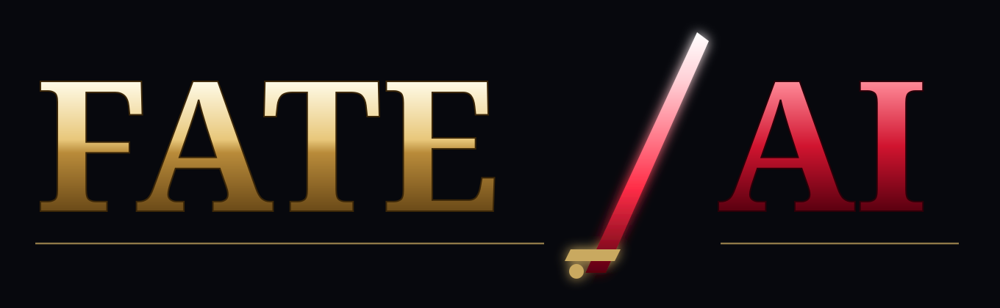

<p align="center">
  
</p>

<p align="center">
  <b>型月 AI 圣杯战争 · 完全体设定集</b><br>
  <i>The TYPE-MOON AI Holy Grail War — Complete Material</i><br>
  <i>型月AI聖杯戦争・完全版設定資料集</i>
</p>

<p align="center">
  <a href="https://fate.emmm.si">🌐 在线访问 fate.emmm.si</a> ·
  中文 / English / 日本語 · Dark / Light
</p>

---

## 这是什么

**FATE/AI** 是一个以《Fate/Zero》为主、参考 FGO 等型月作品设定与风格的**同人二创设定集网页**：
把当下的 AI 大模型与它们背后的公司 / 人物，写成一场争夺「AGI 圣杯」的圣杯战争。

| 层级 | 职阶 | 从者 / 存在 | 御主 / 所属 |
| --- | --- | --- | --- |
| 上三骑 | Saber | Gemini | 哈萨比斯 & Google |
| 上三骑 | Archer | Qwen | 阿里高层 / 通义原研 |
| 上三骑 | Lancer | Kimi | 杨植麟 |
| 下四骑 | Rider | GPT | Sam Altman |
| 下四骑 | Caster | Claude | Dario Amodei |
| 下四骑 | Assassin | GLM | 智谱 |
| 下四骑 | Berserker | Grok | Elon Musk |
| Extra | Ruler | DeepSeek | 梁文锋 |
| 灾厄 | Unbeast / Beast VII | 懂王 | MAGA / 白宫 |
| 局外人 | 第二法魔法使 | 老黄 | NVIDIA |

每位角色都有完整的「从者资料卡」：型月模板、召唤圣遗物、六维面板（雷达图 + 条形图）、御主档案、保有技能、宝具与阵营剧本。

## 功能

- **型月风格主题**：Fate/Zero 式暗夜金红配色、旋转魔法阵首屏、令咒纹章、FATE/AI 圣剑斜杠 Logo
- **亮色 / 暗色模式**：右上角一键切换，记住选择（亮色为羊皮纸「资料集」风格）
- **三种语言**：中文 / English / 日本語，右上角切换，切换时保持当前阅读位置；首次访问按浏览器语言自动选择，也可用 `?lang=zh|en|ja` 指定
- **左侧导览条**（宽屏）：头像 + 职阶目录、当前章节高亮、阅读进度条
- **立绘大图查看**：点击立绘放大，`←` `→` 切换角色，`Esc` 关闭
- **座次总览 + 六维面板横向对照**：点击行直接跳转到对应角色
- 响应式布局，手机可读；纯静态页面，无构建步骤、无框架依赖

## 目录结构

```
.
├── index.html            # 整个网页（样式、中文设定数据 DATA、渲染逻辑都在这里）
├── i18n/
│   ├── zh.json           # 从 index.html 抽取出的中文可翻译内容（翻译用的底稿）
│   ├── en.json / ja.json # 英文 / 日文翻译（结构与 zh.json 完全一致）
│   └── en.js / ja.js     # 由 json 生成，网页实际加载的文件
├── scripts/
│   ├── extract-zh.js     # 从 index.html 抽取中文内容 → i18n/zh.json
│   └── build-i18n.js     # i18n/*.json → i18n/*.js
├── assets/
│   ├── logo.svg          # FATE/AI Logo
│   └── thumbs/           # 立绘缩略图（首页、目录、表格使用）
├── 纯立绘/               # 原始立绘（详情页与大图使用）
└── 角色设定图/           # 角色设定图原图
```

## 本地预览

直接双击 `index.html` 即可打开；或者起一个本地服务器：

```bash
python3 -m http.server 8765
# 浏览器打开 http://localhost:8765
```

## 修改设定 / 翻译

1. **改中文设定**：编辑 `index.html` 里的 `const DATA = [...]`（每个角色一个对象；`**加粗**` 语法可用）。
2. **同步到翻译底稿**：
   ```bash
   node scripts/extract-zh.js index.html i18n/zh.json
   ```
3. **更新英文 / 日文**：按 `zh.json` 的结构修改 `i18n/en.json`、`i18n/ja.json`（键名、数组长度和顺序必须一致）。
4. **生成网页用的翻译脚本**：
   ```bash
   node scripts/build-i18n.js
   ```

界面文字（按钮、表头、标题等）在 `index.html` 的 `const UI = {...}` 中，三种语言各一份。

## 部署

站点是纯静态文件，任何静态服务器都能托管。当前线上环境为 Caddy：

```caddy
fate.emmm.si {
	root * /var/www/fate-ai
	encode zstd gzip
	file_server {
		hide .git .gitignore
	}
}
```

更新线上版本：

```bash
git push
ssh root@<server> 'cd /var/www/fate-ai && git pull'
```

## 声明

- 本项目为**同人二创 / 讽刺娱乐**作品，所有设定均为戏仿与玩梗，不代表对任何真实人物、公司或产品的事实陈述。
- Fate 系列及相关角色、名词版权归 **TYPE-MOON** 所有。
- 文中出现的公司与产品名称均为其各自所有者的商标。
